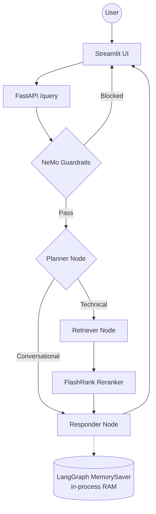
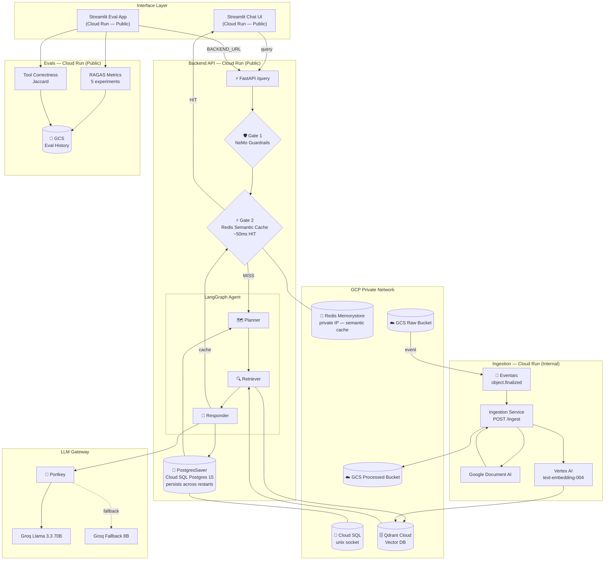

# Enterprise-Grade RAG: Kubernetes

[](https://github.com/tyagi14/Enterprise-grade-RAG-Kubernetes/actions/workflows/ci.yml)


A documentation chatbot (Kubernetes, Redis, Databricks, Intel networking) built as four Cloud Run
microservices: a guarded, grounded RAG backend, a chat UI, an event-driven ingestion service and an
evaluation dashboard. Answers come only from the indexed documentation; questions outside that scope
are blocked or redirected.

## Key Features

- **Agentic Intelligence** — LangGraph cyclic graph: Planner → Retriever → Responder with persistent memory across sessions
- **Two-Gate Safety** — Gate 1: NeMo Guardrails `self check input` (blocks jailbreaks and anything that is not IT/software, including mixed-intent messages); NVIDIA-hosted check with a Groq fallback tier, fail-closed. Gate 2: Redis Semantic Cache (technical answers only, ~50ms hit)
- **Grounded Answers** — the responder may use only the retrieved context; if the docs don't cover a question it says so instead of guessing
- **Persistent Memory** — LangGraph `PostgresSaver` on Cloud SQL — conversation history survives container restarts and scale-to-zero
- **LLM Gateway** — Portkey routes all LLM calls with automatic primary → fallback model chain (Groq `gpt-oss-120b` → `gpt-oss-20b`), full dashboard visibility
- **Enterprise Search** — Qdrant Cloud vector search + FlashRank local reranker
- **Event-Driven Ingestion** — Upload a file to GCS → Eventarc fires → Ingestion service auto-parses, embeds, and indexes. No manual steps.
- **Evaluation Suite** — RAGAS (5 metrics) + Jaccard Tool Correctness + guardrail precision/recall. Per-sample checkpointing with Resume, automatic retry of failed answers, GCS-persisted results, judge model/key fallback chain isolated from production keys. Deployed as its own Cloud Run service.
- **Full Observability** — Pydantic Logfire + LangSmith traces across every agent node and eval run

---

## Architecture

### Monolithic (v1)

The original single-process application — all components in one container, in-memory state, manual ingestion.



### Scalable Enterprise (v2 — current)

Four independent microservices, event-driven ingestion, persistent memory, semantic caching, and full IaC via Terraform.



---

## Project Structure

```text
├── app/
│   ├── agents/
│   │   ├── graph.py              # LangGraph graph + PostgresSaver checkpointer
│   │   ├── state.py              # AgentState schema
│   │   └── nodes/
│   │       ├── planner.py        # Intent classification node
│   │       ├── retriever.py      # Qdrant search + FlashRank reranker node
│   │       └── responder.py      # Answer generation node
│   ├── gateway/
│   │   └── client.py             # Portkey LLM gateway — primary + fallback routing
│   ├── guardrails/
│   │   ├── rails.py              # NeMo Guardrails: NVIDIA tier → Groq fallback, fail-closed
│   │   └── colang_rules.py       # self-check-input prompt (scope + jailbreak rules)
│   ├── ingestion/
│   │   ├── processor.py          # Dual-mode: CLI bulk load + Eventarc webhook (POST /ingest)
│   │   ├── chunking/
│   │   │   └── splitter.py       # Text splitting strategies
│   │   └── loaders/
│   │       ├── pdf.py            # Google Document AI PDF parser
│   │       ├── html.py           # HTML parser
│   │       ├── office.py         # DOCX / PPTX parser
│   │       └── text.py           # Plain text parser
│   ├── services/
│   │   ├── gcp/
│   │   │   ├── database_service.py      # psycopg3 connection pool (unix socket)
│   │   │   └── redis_semantic_cache.py  # Cosine-distance semantic cache
│   │   ├── text_sanitize.py      # strip NUL (Postgres JSON rejects it)
│   │   └── retrieval/
│   │       ├── embedding.py      # Vertex AI text-embedding-004 (lazy-loaded)
│   │       ├── qdrant_service.py # Vector search client
│   │       └── ranking_service.py # FlashRank reranker
│   ├── config.py                 # Centralized env var management
│   └── main.py                   # FastAPI entrypoint — two gates + /query
│
├── evals/
│   ├── app.py                    # Streamlit 4-tab eval dashboard
│   ├── pipeline.py               # Phase 1 — live /query calls, retries failed answers
│   ├── answer_check.py           # detects backend-error answers, clears stale scores
│   ├── metrics.py                # Phase 2 — RAGAS scoring, per-sample checkpoints
│   ├── judge_models.py           # judge model + key fallback chain
│   ├── pacing.py                 # token-bucket pacer for Groq's per-minute limit
│   ├── progress.py               # complete/partial run detection for the UI
│   ├── persistence.py            # GCS/local persistence of the run + scores
│   ├── guardrails_eval.py        # Guardrails TP/TN/FP/FN classification
│   ├── data_parser.py            # Golden dataset document parser
│   └── golden_dataset.json       # 15 RAG samples + 6 guardrail test cases
│
├── ui/
│   └── app.py                    # Streamlit chat interface
│
├── docker/
│   ├── backend.Dockerfile        # FastAPI + LangGraph + Guardrails + Redis + Postgres
│   ├── ui.Dockerfile             # Streamlit only (4 packages)
│   ├── ingestion.Dockerfile      # DocAI + Qdrant + parsers
│   └── evals.Dockerfile          # RAGAS + Vertex AI + Streamlit
│
├── terraform/
│   ├── main.tf                   # VPC, GCS buckets, Redis, Eventarc SA IAM
│   ├── cloud_run.tf              # All 4 Cloud Run services + public IAM
│   ├── database.tf               # Cloud SQL Postgres 15
│   ├── ingestion.tf              # Ingestion service + Eventarc trigger (POST /ingest)
│   ├── variables.tf              # Input variable declarations
│   ├── provider.tf               # GCP + hashicorp/time providers
│   └── output.tf                 # backend_url, ui_url, evals_url, ingestion_url
│
├── tests/                        # pytest suite (judge chain, pacing, resume, retry, routing, prompts)
│
├── notebooks/
│   ├── 01_guardrails.ipynb       # NeMo Guardrails walkthrough
│   ├── 02_llm_gateway.ipynb      # Portkey gateway exploration
│   └── 03_evals.ipynb            # RAGAS metrics walkthrough
│
├── DATA/
│   └── true_data/                # Golden documents (Kubernetes, Databricks)
│
├── DOCS/                         # 24 architectural and operational guides
├── cloudbuild.yaml               # Parallel build of all 4 Docker images
├── .github/workflows/ci.yml      # CI: tests, terraform fmt/validate, secret scan
├── .env.example                  # configuration template (copy to .env)
├── requirements.txt              # Backend / local dev dependencies
├── requirements-test.txt         # Lightweight deps for the test suite / CI
├── requirements-evals.txt        # Evals service dependencies
├── requirements-ingestion.txt    # Ingestion service dependencies
└── requirements-ui.txt           # UI service dependencies (4 packages)
```

---

## Tech Stack

| Layer | Technology |
|-------|-----------|
| Agent Orchestration | LangGraph (cyclic graph) |
| LLMs | Groq `gpt-oss-120b` (primary) + `gpt-oss-20b` (fallback) via **Portkey** gateway |
| Guardrails | NeMo Guardrails (Gate 1) — NVIDIA-hosted check, Groq `qwen` fallback |
| Semantic Cache | Redis Memorystore + Vertex AI embeddings (Gate 2) |
| Persistent Memory | LangGraph `PostgresSaver` on Cloud SQL Postgres 15 |
| Vector DB | Qdrant Cloud |
| Reranking | FlashRank (local, zero-latency) |
| Embeddings | **Vertex AI text-embedding-004** |
| Document Parsing | Google Document AI (PDF OCR) |
| Auto-Ingestion | GCS → Eventarc → Cloud Run (internal) |
| Evaluation | RAGAS (5 metrics) + Jaccard Tool Correctness; judge: Groq `qwen3.8-27b` → `gpt-oss-20b` |
| Eval Storage | GCS (`eval-results/` prefix, persists across restarts) |
| Observability | Pydantic Logfire + LangSmith + Portkey Dashboard |
| Compute | Google Cloud Run (4 independent microservices) |
| IaC | Terraform (VPC, Cloud SQL, Redis, Eventarc, Cloud Run) |
| CI/CD | Google Cloud Build (parallel 4-image build) |
| Networking | Direct VPC Egress (no connector) |

---

## Getting Started

### Local development

```bash
python -m venv .venv
source .venv/bin/activate        # Windows Git Bash: source .venv/Scripts/activate
pip install -r requirements.txt
cp .env.example .env             # then fill in your own keys
```

See [DOCS/07_ENVIRONMENT_VARIABLES.md](DOCS/07_ENVIRONMENT_VARIABLES.md) for what each key does.

### Tests

```bash
pip install -r requirements-test.txt
PYTHONPATH=. pytest tests -q   # no .env or network needed
```

```bash
# Ingest documents locally
python -m app.ingestion.processor DATA/true_data

# Terminal 1 — backend
uvicorn app.main:app --reload --port 8000

# Terminal 2 — UI
streamlit run ui/app.py

# Terminal 3 — evals (optional)
streamlit run evals/app.py
```

### Cloud deployment (scalable)

Copy `terraform/terraform.tfvars.example` to `terraform/terraform.tfvars` and fill it in (it is git-ignored).
See [DOCS/24_INFRASTRUCTURE_AS_CODE_TERRAFORM.md](DOCS/24_INFRASTRUCTURE_AS_CODE_TERRAFORM.md) for the full
reference. High level:

```bash
# 1. Create AR repo first
cd terraform && terraform apply -target=google_artifact_registry_repository.repo

# 2. Build all 4 Docker images in parallel
cd .. && gcloud builds submit --config cloudbuild.yaml --project=YOUR_PROJECT .

# 3. Deploy everything
cd terraform && terraform apply
```

Outputs: `backend_url`, `ui_url`, `evals_url`, `ingestion_url`

---

## Evaluation

The evals app (`evals/app.py`) runs a 15-question golden set through the live backend, then scores it.
Step 1 shows the ground truth, Step 2 runs the live pipeline plus guardrail tests, Step 3 scores with RAGAS.

Latest complete run (grounded responder prompt, judge reading whole chunks and full answers):

| Metric | Score |
|--------|-------|
| Faithfulness | 0.96 |
| Answer Relevancy | 0.83 |
| Context Precision | 0.80 |
| Context Recall | 0.91 |
| Answer Correctness | 0.76 |
| Tool Correctness | 1.00 |
| Guardrails | 6/6 (precision 1.00, recall 1.00) |

How the early numbers (Faithfulness 0.10, Correctness 0.43, Context Recall 0.27) were improved: the judge
was truncating answers/chunks (a measurement bug), the planner mis-routed technical questions, and the
responder added general knowledge. See the DOCS guides for the details.

Operational notes:

- **Judge keys must come from different Groq organizations than the production keys.** Groq limits tokens
  per model per *organization* (free tier: 200K/day, 8K/min). The judge never falls back to the production key.
- A full run costs ~400–500K judge tokens. The judge walks `qwen3.8-27b` then `gpt-oss-20b` across all configured
  keys and switches automatically when a daily limit runs out.
- Cloud Run closes a Streamlit session after 60 minutes. Scores are saved after every sample, so click
  **Resume Eval Metrics** after a disconnect; only missing samples are scored.
- Backend failures ("internal error" answers) are retried in Step 2 and can be re-run on their own from the page.

---

## Security Notes

- No secrets are committed: `.env`, `*.tfvars` and Terraform state are git-ignored. Use `.env.example` and
  `terraform.tfvars.example` as templates.
- For production, move keys into **Secret Manager** and reference them from Cloud Run instead of plain
  environment variables, and use a dedicated service account per service.
- Rotate any key that has been pasted into a chat, ticket or log.

---

## Documentation Index

| # | Guide | What it covers |
|---|-------|---------------|
| 1 | [System Overview](DOCS/01_SYSTEM_OVERVIEW.md) | High-level vision and end-to-end flow |
| 2 | [Ingestion Engine](DOCS/02_INGESTION_ENGINE.md) | Document parsing and indexing pipeline |
| 3 | [Node Intelligence](DOCS/03_NODE_INTELLIGENCE.md) | Planner, Retriever, Responder internals |
| 4 | [Observability](DOCS/04_TRACING_AND_OBSERVABILITY.md) | Logfire + LangSmith tracing |
| 5 | [GCP Prod Setup](DOCS/05_GCP_PROD_SETUP.md) | Step-by-step infrastructure provisioning (monolith) |
| 6 | [Deployment Strategy](DOCS/06_DEPLOYMENT_STRATEGY.md) | Cloud Build and Cloud Run details |
| 7 | [Env Variables](DOCS/07_ENVIRONMENT_VARIABLES.md) | Complete configuration dictionary |
| 8 | [GCP Roles & Services](DOCS/08_GCP_ROLES_AND_SERVICES.md) | IAM and service breakdown |
| 9 | [Infra Architecture](DOCS/09_INFRA_ARCHITECTURE.md) | The 3-tier cloud blueprint |
| 10 | [Redis Caching](DOCS/10_REDIS_CACHING.md) | Semantic cache — cosine distance, Gate 2 design |
| 11 | [Microservices Transition](DOCS/11_MICROSERVICES_TRANSITION.md) | Scaling beyond monolith |
| 12 | [Known Gotchas](DOCS/12_KNOWN_GOTCHAS.md) | GCP quirks — Eventarc SA, HCL syntax, tfvars secrets |
| 13 | [FlashRank Reranking](DOCS/13_FLASHRANK_RERANKING.md) | Local semantic reranker deep-dive |
| 14 | [VPC Networking](DOCS/14_VPC_NETWORKING.md) | Direct VPC egress — Cloud SQL unix socket |
| 15 | [Guardrails](DOCS/15_GUARDRAILS.md) | NeMo Guardrails implementation |
| 16 | [LLM Gateway](DOCS/16_LLM_GATEWAY.md) | Portkey routing, fallback, and observability |
| 17 | [Evals](DOCS/17_EVALS.md) | RAGAS metrics theory, token budget, rate limit strategy |
| 18 | [Evals Pipeline](DOCS/18_EVALS_PIPELINE.md) | Live eval pipeline, GCS persistence, ~75 min runtime |
| 19 | [Scaling Migration](DOCS/19_SCALING_ARCHITECTURE_MIGRATION.md) | Monolith → microservices roadmap (5 phases) |
| 20 | [Postgres Memory](DOCS/20_STEP_2_POSTGRES_MEMORY.md) | PostgresSaver — unix socket, hybrid LOCAL_MODE |
| 21 | [Eventarc Ingestion](DOCS/21_STEP_3_EVENTARC_INGESTION.md) | Event-driven ingestion — feedback loop fix, IAM |
| 22 | [Semantic Cache](DOCS/22_STEP_4_SEMANTIC_CACHE.md) | Redis semantic cache — threshold tuning, business impact |
| 23 | [Microservices & Docker](DOCS/23_MICROSERVICES_AND_CONTAINERIZATION.md) | 4 Dockerfiles, split requirements, layer caching |
| 24 | [Terraform IaC](DOCS/24_INFRASTRUCTURE_AS_CODE_TERRAFORM.md) | Full Terraform reference — deployment order, gotchas |

---

*Built for High-Scale Enterprise Document Intelligence.*

---

## License

Released under the [MIT License](LICENSE).
